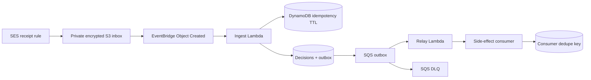
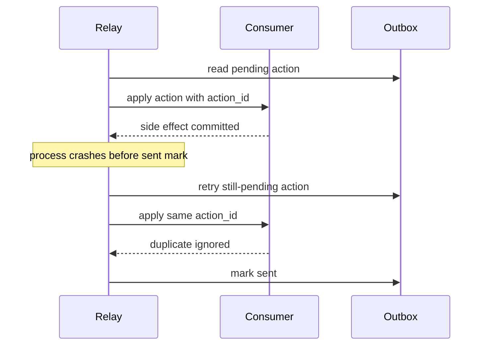

# Idempotent Inbox Triage

Idempotent Inbox Triage is a small AWS-oriented example for Northwind Widgets, a fictional company. It accepts synthetic inbound `.eml` messages, evaluates versioned YAML rules, records a decision, and emits actions through a transactional outbox.

## The problem

S3 notifications, EventBridge, Lambda retries, and queue redelivery are at-least-once delivery mechanisms. A message can arrive more than once, or a worker can fail after an external action succeeds but before the worker records success. A naïve consumer can therefore apply the same label, forward the same mail, or send the same notification several times.

## The pattern

The message ID and rule-set version form the input to a SHA-256 idempotency key:

`sha256(message-id + rule-set version)`

Processing makes a conditional insert for that key. The decision and its outbox rows are inserted in one SQLite transaction in the local implementation. The transaction either creates both the decision and all pending actions, or creates neither. A relay delivers pending rows. The consumer has its own conditional insert keyed by an action ID, so a relay crash after the side effect and before marking the row sent is safe to retry.

The local repository is intentionally shaped like a DynamoDB conditional put. The AWS deployment contains a TTL-backed idempotency table, a decisions/outbox table, an SQS queue and DLQ, and Lambda roles. The Python local implementation remains runnable without AWS credentials.

## Architecture



## Crash sequence



## Run locally

After installing the small development dependency set, one command seeds 200 deterministic fixtures and processes them:

```text
python3 -m pip install -r requirements.txt
make run-local
```

The command writes fixtures under `fixtures/eml/` and uses `.triage.sqlite`. It is safe to run again: the same message IDs and rule-set version resolve to the same keys, so decisions are not duplicated. To inspect pending actions:

```text
PYTHONPATH=src python3 -m triage relay --db .triage.sqlite
PYTHONPATH=src python3 -m triage replay --db .triage.sqlite
```

Dry run evaluates and prints decisions without writing a decision or outbox row:

```text
PYTHONPATH=src python3 -m triage --dry-run run fixtures/eml --db /tmp/triage-dry-run.sqlite
```

The rules file contains exactly ten sample rules and is versioned at `rules/rules.yaml`. Rules demonstrate sender address, sender domain, subject regex, body keywords, headers, and attachment extensions. Actions are declarative `label`, `forward`, `notify`, and `archive` values.

## Explaining a decision

`why` evaluates one message without writing it:

```text
PYTHONPATH=src python3 -m triage why fixtures/eml/fixture-0000.eml
```

Representative output:

```text
message_id: <fixture-0000@example.com>
rule_set_version: 2026-01
idempotency_key: 4a19ba69...8baf89  (sha256, truncated here)
matched_rules: urgent-priority, pdf-attachment, widget-support, security-review
rule urgent-priority: MATCH
  yes header: header value comparison
rule pdf-attachment: MATCH
  yes attachments: attachment presence and extension comparison
rule widget-support: MATCH
  yes body_keywords: found 2/2 keywords
actions:
  label=urgent (rule=urgent-priority)
  notify=urgent@example.net (rule=urgent-priority)
  label=attachment-review (rule=pdf-attachment)
  archive=True (rule=pdf-attachment)
  label=support (rule=widget-support)
  forward=support@example.com (rule=widget-support)
  label=security (rule=security-review)
  notify=security@example.net (rule=security-review)
```

The full command prints non-matching conditions too, including the expected value, observed value, and a plain-language reason.

## Tests

```text
make test
make tf-validate
```

The tests cover five duplicate deliveries, a relay crash after the consumer side effect, a crash before the SQLite commit, rule-set version changes, dry run, `why` output, MIME attachments, and all 200 seeded fixtures. Terraform validation is offline with `terraform init -backend=false`; no credentials or apply step are needed.

## Tradeoffs

- Key choice: message ID is stable and available in the MIME envelope, but a sender that reuses a message ID could be incorrectly collapsed. A production system may combine provider event ID, mailbox identity, and normalized content where appropriate.
- TTL window: the AWS idempotency record needs to live longer than the maximum retry and replay window. A short TTL permits late duplicates; a very long TTL increases storage and complicates legitimate reprocessing.
- Outbox latency: actions are eventually delivered, not completed in the ingest request. This is the cost of keeping the decision transaction independent from unreliable external calls.
- Exactly-once: the system does not make a network side effect exactly once. It makes the result effectively once by requiring the consumer to deduplicate a stable action ID.
- Cost: DynamoDB on-demand, SQS, Lambda, S3, SES, CloudWatch logs, and EventBridge are individually small at low volume, but retention, log volume, and SES/S3 usage still need budgets.

## What I would do in production

I would replace the local SQLite transaction with DynamoDB `TransactWriteItems`, record the idempotency TTL explicitly, and use a DynamoDB conditional write at both the ingress and consumer boundaries. I would make the outbox publisher and action consumers first-class services with bounded retries, a DLQ replay runbook, structured correlation IDs, metrics for duplicate suppression and age of the oldest pending row, and alarms for SES, Lambda, SQS, and DynamoDB failures. I would also validate MIME size and content type, scan attachments, restrict forwarding destinations, manage the rule set through reviewed releases, and keep the synthetic-domain fixtures out of production data paths.

## Repository layout

- `src/triage/`: parser, rule engine, idempotency store, repository, relay, CLI, and Lambda handlers.
- `rules/rules.yaml`: ten versioned declarative rules.
- `scripts/seed.py`: deterministic 200-message fixture generator.
- `fixtures/eml/`: generated synthetic `.eml` fixtures.
- `infra/`: Terraform resources and GitHub OIDC deployment role.
- `.github/workflows/ci.yml`: tests, Terraform checks, gitleaks, and deny-list checks.
